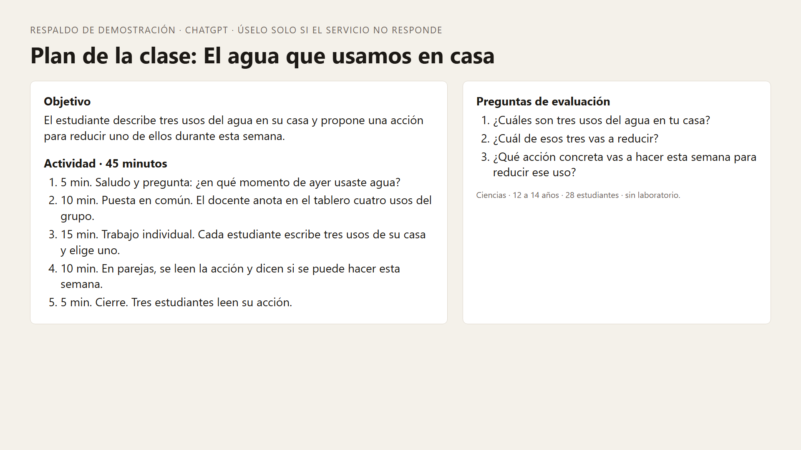
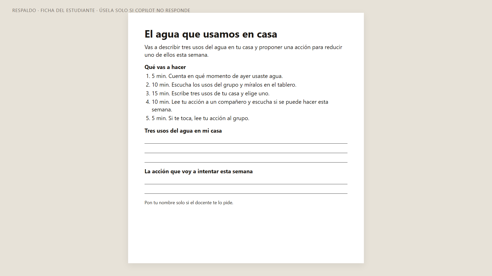
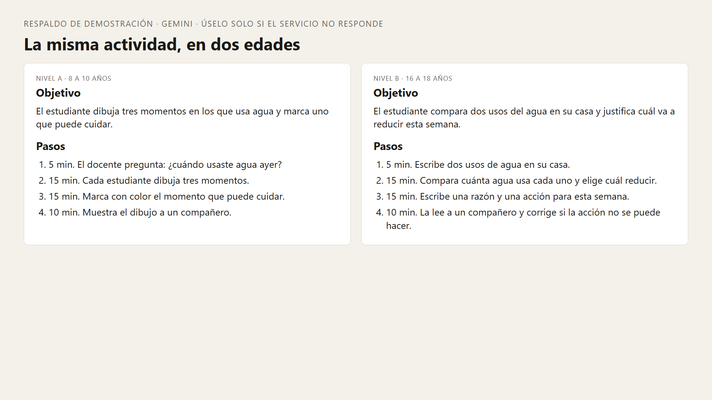
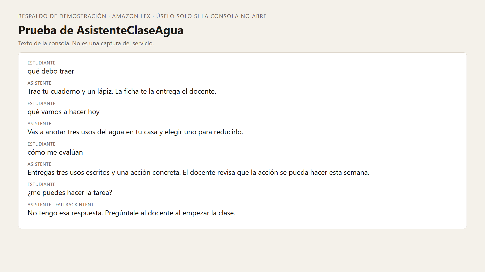

# Asistentes de IA para docentes: ChatGPT, Copilot, Gemini y Lex en acción

## Plataforma de demostraciones

Te damos la bienvenida a la plataforma de demostraciones del seminario Asistentes de IA para docentes: ChatGPT, Copilot, Gemini y Lex en acción.

Las cuatro demostraciones construyen una misma experiencia de aprendizaje sobre el tema “El agua que usamos en casa”. Cada herramienta aporta una parte: el plan de clase, la ficha del estudiante, la adaptación para diferentes edades y un asistente para responder preguntas frecuentes.

La clase que se diseña tiene una duración de 45 minutos y está dirigida inicialmente a estudiantes de 12 a 14 años.

Consulta la [guía completa del taller](Capitulo01/README.md) para revisar los prerrequisitos, las cuentas necesarias, la preparación del entorno y los prompts.

## Demostraciones

### [Demostración 1 — ChatGPT](Capitulo01/README.md#demostración-1--chatgpt)

- Descripción: Generar el objetivo, la actividad, las preguntas de evaluación y los materiales de una clase de ciencias. Revisar el resultado y realizar una corrección para mostrar la intervención del docente en el diseño.
- Resultado: Plan de clase y contenido que servirá como entrada para las siguientes demostraciones.
- [Ver imagen de respaldo](respaldo-demo/01-chatgpt-plan.png).
- [Ver respaldo en HTML](respaldo-demo/_html/01.html).

### [Demostración 2 — Microsoft Copilot](Capitulo01/README.md#demostración-2--microsoft-copilot)

- Descripción: Transformar el plan de clase en una ficha de una página dentro de Word. Convertir los pasos de la actividad en una lista de verificaciones, conservando el objetivo, los tiempos y los espacios de respuesta.
- Resultado: Ficha del estudiante preparada en Word.
- [Descargar documento de trabajo Ficha-agua.docx](Ficha-agua.docx).
- [Ver imagen de respaldo](respaldo-demo/02-copilot-ficha.png).
- [Ver respaldo en HTML](respaldo-demo/_html/02.html).

### [Demostración 3 — Google Gemini](Capitulo01/README.md#demostración-3--google-gemini)

- Descripción: Complementar la actividad con un dato verificable y dos ejemplos concretos. Adaptar la misma actividad para estudiantes de 8 a 10 años y de 16 a 18 años.
- Resultado: Ejemplos de acciones para cuidar el agua y dos adaptaciones de la actividad.
- [Ver imagen de respaldo](respaldo-demo/03-gemini-niveles.png).
- [Ver respaldo en HTML](respaldo-demo/_html/03.html).

### [Demostración 4 — Amazon Lex](Capitulo01/README.md#demostración-4--amazon-lex)

- Descripción: Probar un asistente previamente configurado para responder preguntas sobre los materiales, la actividad y la evaluación de la clase. Comprobar cómo responde ante una solicitud fuera de su alcance.
- Resultado: Validación de las respuestas del asistente y de su mecanismo de respuesta alternativa.
- [Ver imagen de respaldo](respaldo-demo/04-lex-prueba.png).
- [Ver respaldo en HTML](respaldo-demo/_html/04.html).

## Materiales y recursos

### Documento de trabajo

- [Ficha-agua.docx](Ficha-agua.docx): documento de trabajo para la demostración de Microsoft Copilot en Word. Descárgalo, súbelo a OneDrive y ábrelo desde Word para seguir las instrucciones de la guía.

Los archivos Word se descargan o se abren mediante una aplicación compatible; GitHub Pages no los convierte en páginas web.

-----

### Carpeta respaldo-demo

Las imágenes siguientes son materiales de respaldo preparados para las demostraciones. No son capturas de los servicios.

#### 01-chatgpt-plan.png

Objetivo de la clase, secuencia de actividades y preguntas de evaluación.

[Ver imagen completa](respaldo-demo/01-chatgpt-plan.png).

#### 02-copilot-ficha.png

Ficha del estudiante con el objetivo, los pasos de la actividad y los espacios para registrar sus respuestas.

[Ver imagen completa](respaldo-demo/02-copilot-ficha.png).

#### 03-gemini-niveles.png

Adaptación de la actividad para estudiantes de diferentes edades.

[Ver imagen completa](respaldo-demo/03-gemini-niveles.png).

#### 04-lex-prueba.png

Respuestas del asistente a preguntas frecuentes y ejemplo de una solicitud fuera de alcance.

[Ver imagen completa](respaldo-demo/04-lex-prueba.png).

### Versiones HTML de los respaldos

Estas páginas permiten consultar los respaldos directamente desde el navegador.

| Archivo | Contenido |
|---|---|
| [01.html](respaldo-demo/_html/01.html) | Respaldo de ChatGPT: plan de clase. |
| [02.html](respaldo-demo/_html/02.html) | Respaldo de Microsoft Copilot: ficha del estudiante. |
| [03.html](respaldo-demo/_html/03.html) | Respaldo de Google Gemini: adaptación por edades. |
| [04.html](respaldo-demo/_html/04.html) | Respaldo de Amazon Lex: prueba del asistente. |

### Archivo técnico de apoyo

- [_build_docx.py](respaldo-demo/_build_docx.py): script utilizado para generar el documento Word. Contiene una ruta local que debe ajustarse antes de ejecutarlo. No es necesario ejecutarlo para seguir las demostraciones.

---

## 📬 Contacto y más información

Si tienes alguna pregunta o necesitas más detalles, no dudes en [contactarnos](mailto:soporte@netec.com). También puedes encontrar más recursos en nuestra [página](https://netec.com).

---

¡Gracias por visitar nuestra plataforma! Revisa las demostraciones y explora cómo integrar asistentes de IA en el diseño de experiencias de aprendizaje.
